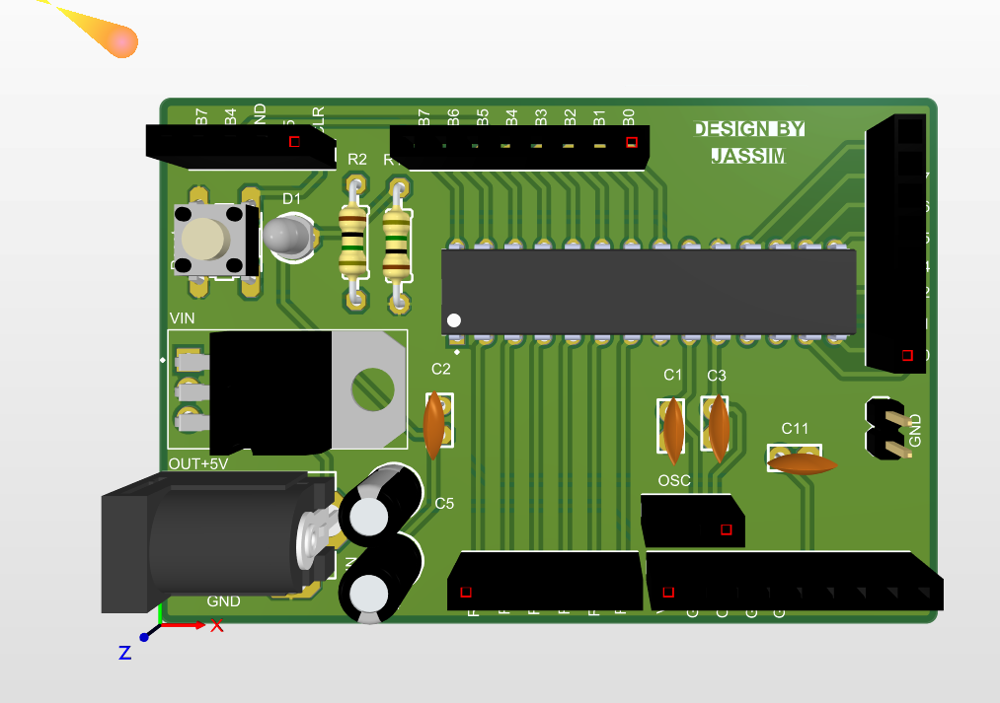
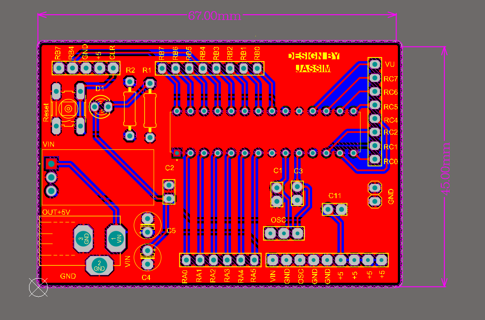

# PIC18F2550 Development Board

A compact microcontroller development board designed in Altium Designer for embedded systems prototyping and PIC peripheral experiments.

**Design status:** Hardware tested and approved for fabrication by the designer.



## Project Overview

The board is based on the Microchip PIC18F2550-I/SP microcontroller in a 28-pin DIP package. It provides GPIO breakout headers, regulated power, a programming interface, manual reset, and an external oscillator connection.

## Hardware Features

| Feature | Design specification |
| --- | --- |
| Microcontroller | PIC18F2550-I/SP (DIP-28) |
| Power regulation | L7805CV, nominal 5 V output |
| Power input | DC barrel jack |
| GPIO expansion | PORT A, PORT B and PORT C headers |
| Programming | ICSP header |
| Clock | External oscillator header with 22 pF capacitors |
| Reset | Push button with 10 kΩ pull-up |
| Indicator | Power LED |
| PCB dimensions | 68 × 46 mm (designer-approved fabrication dimensions) |
| Design software | Altium Designer |

## Design Previews

### Schematic


### PCB Layout



## Design Source Files

| File | Description |
| --- | --- |
| [PIC.SchDoc](Hardware/Schematic/PIC.SchDoc) | Native Altium schematic |
| [PIC18F.PcbDoc](Hardware/PCB/PIC18F.PcbDoc) | Native Altium PCB layout |
| [Design overview](Documentation/Design-Overview.md) | Functional blocks and component reference |
| [Changelog](CHANGELOG.md) | Revision history |
| [Manufacturing files](Manufacturing/README.md) | Gerber and NC drill exports |
| [Fabrication ZIP](Manufacturing/PIC18F2550-Fabrication.zip) | Packaged PCB fabrication outputs |

The native design files are provided as supplied. Open them in Altium Designer. A separate Altium project file and component libraries are not included.

## Repository Structure

```text
PIC18F2550-Development-Board/
├── Hardware/
│   ├── Schematic/PIC.SchDoc
│   └── PCB/PIC18F.PcbDoc
├── Images/
│   ├── 01-schematic.png
│   ├── 02-pcb-2d.png
│   └── 03-pcb-3d.png
├── Manufacturing/
│   ├── Gerber/
│   ├── NC-Drill/
│   ├── PIC18F2550-Fabrication.zip
│   └── README.md
├── Documentation/Design-Overview.md
├── README.md
├── CHANGELOG.md
├── LICENSE
└── .gitignore
```

## Verification and Manufacturing

- Hardware testing and fabrication readiness are reported by the designer.
- Schematic, PCB layout and design previews are included.
- Gerber and NC drill exports are included in [Manufacturing/](Manufacturing/README.md), together with a fabrication ZIP.
- Two copper layers, 68 × 46 mm approved fabrication dimensions, and 97 drill holes across six tool sizes.
- Detailed test records, ERC/DRC reports and a procurement BOM are not included. Review fabrication files in the manufacturer's viewer and obtain DFM approval before ordering boards.

## Release Status

Initial hardware release: [v1.0.0](https://github.com/jassim20/PIC18F2550-Development-Board/releases/tag/v1.0.0), published on 2026-11-25. The release includes the native design files, design previews and technical documentation. Manufacturing outputs are now available in [v1.1.0 — Manufacturing Release](https://github.com/jassim20/PIC18F2550-Development-Board/releases/tag/v1.1.0), published on 2026-11-25.

## License

**Copyright (c) 2026 jassim20. All rights reserved.**

The original project materials are published for portfolio and reference purposes. No general permission to reproduce, modify, redistribute, manufacture from, or commercially exploit the protected materials is granted. Prior written permission is required except where applicable law, GitHub's Terms of Service, or applicable third-party licenses provide otherwise.

See [LICENSE](LICENSE) for the full copyright notice.
